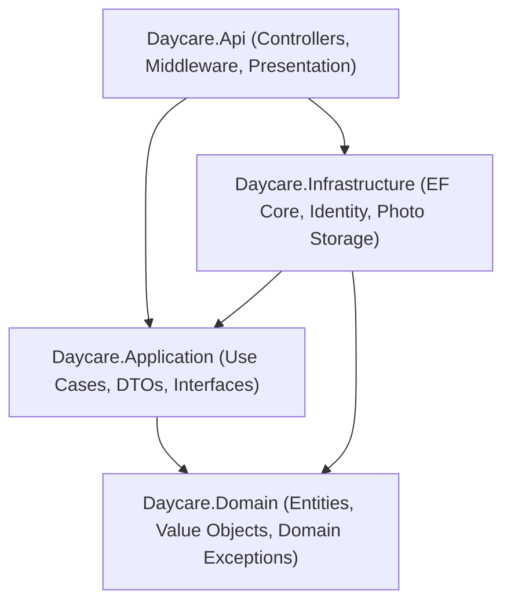

# Daycare Management System

A full-stack daycare management platform providing administrative operations, classroom tracking, staff assignments, daily activity logging, incident reporting, attendance, child-guardian relationships, and billing workflows.

---

## Documentation

Comprehensive architecture, API, data model, and configuration guides are available in the [`docs/`](docs/) directory:

| Document | Focus Areas |
|---|---|
| [Architecture and Design](docs/architecture.md) | Clean Architecture layers, request lifecycle, use case pattern, RFC 7807 problem details, and project tree |
| [Data Model and Schema](docs/data-model.md) | PostgreSQL schema, Entity Framework Core mappings, check constraints, Identity tables, and Mermaid ER diagram |
| [API Reference and Endpoints](docs/api.md) | OpenAPI specification, Scalar UI, pagination conventions, problem details, and controller endpoint tables |
| [Business Rules](docs/business-rules.md) | Operating hours, attendance check-in/out rules, late fees, guardian contacts, billing, and report locks |
| [Profile Photos Specification](docs/photos.md) | Storage architecture, SkiaImageProcessor specifications, upload limits, and caching headers |
| [Configuration Reference](docs/configuration.md) | Complete configuration key reference for `appsettings.json` and environment variables |
| [Security and Authentication](docs/security.md) | JWT token lifecycle, active status checks, lockout rules, role authorization, and architectural limitations |

---

## Features by Role

The system enforces role-based access for three primary user personas: Administrator, Staff, and Parent.

### Administrator
- Facility Dashboard: Aggregated operational metrics including total enrolled children, active staff, room capacity utilization, staff-to-child ratios, and revenue totals.
- Child Management: Full lifecycle enrollment, profile edits, classroom assignments, fee plan linking, guardian relationships, profile photo uploads, and soft deletion.
- Classroom Management: Creation and updates of classrooms, age ranges, room capacity, required staff-to-child ratio thresholds, and staff roster assignments.
- Staff Management: Creation of staff records, user account provisioning, role and job title updates, profile photo management, and password resets.
- Guardian Management: Registration of parent and guardian contacts, portal account provisioning, contact updates, and password resets.
- Attendance Operations: Overview of center-wide attendance, manual check-in and check-out, absence recording, and real-time classroom ratio compliance.
- Daily Reports and Incidents: Center-wide access to daily activity reports and incident logs.
- Announcements: Publishing and deleting facility-wide, staff-only, or classroom-specific announcements.
- Fee Plans: Defining recurring monthly tuition rates and active statuses.
- Billing and Payments: Batch generation of monthly invoices, adding manual adjustments, recording offline payments (Cash, BankTransfer, Telebirr, Other), voiding invoices, and voiding payments.
- Reports: Attendance analytics and financial billing summaries.

### Staff
- Staff Dashboard: Quick view of assigned classrooms, child rosters, attendance statuses, and pending daily reports.
- Attendance: Check-in and check-out of children in assigned classrooms, recording authorized pickup individuals, recording absences, and viewing room ratios.
- Daily Activity Logging: Logging meal consumption, nap duration, diaper and potty events, mood, learning activities, medication, and caregiver notes for checked-in children.
- Incident Reporting: Filing injury or behavioral incident reports, logging corrective actions, and marking parent notifications.
- Classroom Rosters: Viewing emergency contacts, medical notes, allergies, and dietary restrictions for children in assigned classrooms.
- Announcements: Viewing facility-wide, staff-only, and assigned classroom announcements.

### Parent
- Parent Portal: Viewing linked children profiles, emergency details, and daily updates.
- Daily Reports: Real-time feed of child daily reports, meal tracking, nap times, and caregiver notes.
- Incident Reports: Viewing incident reports involving their children and signing digital parent acknowledgments.
- Billing and Statements: Viewing issued invoices, itemized line items, payment history, outstanding balances, and submitting online simulated payments.
- Announcements: Viewing general and classroom-specific announcements.
- Profile: Viewing guardian profile contact details and address.

---

## Tech Stack

The application is built using the following frameworks, libraries, and runtime versions:

### Backend
- Runtime: .NET 10.0 (net10.0)
- Framework: ASP.NET Core with C# 13
- Database Provider: Entity Framework Core 10.0.3 with Npgsql.EntityFrameworkCore.PostgreSQL 10.0.3 and EFCore.NamingConventions 10.0.1
- Authentication: Microsoft.AspNetCore.Authentication.JwtBearer 10.0.3
- Identity: Microsoft.AspNetCore.Identity.EntityFrameworkCore 10.0.3
- Validation: FluentValidation 11.11.0 and FluentValidation.DependencyInjectionExtensions 11.11.0
- Image Processing: SkiaSharp 4.153.1 and SkiaSharp.NativeAssets.Linux.NoDependencies 4.153.1
- API Documentation: Microsoft.AspNetCore.OpenApi 10.0.3, Microsoft.OpenApi 2.12.2, and Scalar.AspNetCore 2.0.18
- Architecture Testing: NetArchTest.Rules 1.3.2
- Unit Testing: xUnit 2.9.3, xunit.runner.visualstudio 3.1.4, NSubstitute 5.3.0, Shouldly 4.3.0, Microsoft.NET.Test.Sdk 17.14.1, coverlet.collector 6.0.4

### Frontend
- Framework: Angular 19.2.0
- Component Dev Kit: @angular/cdk 19.2.19
- Language: TypeScript 5.7.2
- Reactive Programming: RxJS 7.8.0
- Routing: Angular Router 19.2.0
- Build System: Angular CLI 19.2.27 with Vite and esbuild
- Styling: Tailwind CSS 3.4.19 with PostCSS 8.5.29 and Autoprefixer 10.6.1
- Test Runner: Karma 6.4.4 with Jasmine 5.6.0 and ChromeHeadless

### Infrastructure
- Database: PostgreSQL 16 (via Docker Compose)
- Container Engine: Docker Compose v2

---

## Architecture Overview

The backend follows Clean Architecture principles separated into four distinct projects, enforcing a strict unidirectional dependency rule toward the Domain core:



For full details on request lifecycle, middleware, use cases, error handling, and folder layout, see [Architecture and Design](docs/architecture.md).

---

## Getting Started

### Prerequisites
- .NET 10.0 SDK
- Node.js 20+ and npm 10+
- Docker and Docker Compose

### 1. Start the Database
Start the PostgreSQL container:
```bash
docker compose up -d
```
The database runs on port 5433 (mapped to container port 5432).

### 2. Run the Backend API
```bash
dotnet run --project src/Daycare.Api
```
The API starts at http://localhost:5080. In Development mode, EF Core automatically applies all database migrations and executes `DataSeeder.SeedRolesAndAdminAsync()` and `DataSeeder.SeedCoreRecordsAsync()`.

### 3. Run the Frontend
In a separate terminal:
```bash
cd frontend
npm install
npm start
```
The Angular single-page application is served at http://localhost:4200. API requests target the backend at http://localhost:5080.

### Seeded Demo Accounts (Development Only)
The database seeder provisions 9 user accounts and 24 children:

| Role | Email | Password | Full Name / Classroom |
|---|---|---|---|
| Admin | admin@daycare.local | Admin@12345 | Daycare Admin |
| Staff | staff1@daycare.local | Staff@12345 | Almaz Bekele (Infants) |
| Staff | staff2@daycare.local | Staff@12345 | Tigist Alemu (Toddlers) |
| Staff | staff3@daycare.local | Staff@12345 | Dawit Haile (Preschool) |
| Parent | parent1@daycare.local | Parent@12345 | Abebe Tadesse |
| Parent | parent2@daycare.local | Parent@12345 | Marta Kebede |
| Parent | parent3@daycare.local | Parent@12345 | Solomon Girma |
| Parent | parent4@daycare.local | Parent@12345 | Hiwot Alemu |
| Parent | parent5@daycare.local | Parent@12345 | Berhanu Worku |

A fourth staff member (`meseret.staff@daycare.local`) is seeded as an active staff record without a login user account.

### Resetting the Database
To clear all data and start from a clean state:
```bash
docker compose down -v
docker compose up -d
```
Restarting the backend will re-apply migrations and re-seed the core records.

---

## Testing

### Backend Tests
Run the entire backend test suite:
```bash
dotnet test
```

Pass counts:
- Daycare.Domain.Tests: 61 passed, 0 failed
- Daycare.Architecture.Tests: 6 passed, 0 failed
- Daycare.Application.Tests: 175 passed, 0 failed
- Total Backend: 242 passed, 0 failed

### Frontend Tests
Run the Angular Karma test suite in headless mode:
```bash
cd frontend
npm test -- --watch=false --browsers=ChromeHeadless
```

Pass count:
- Total Frontend: 14 passed, 0 failed
