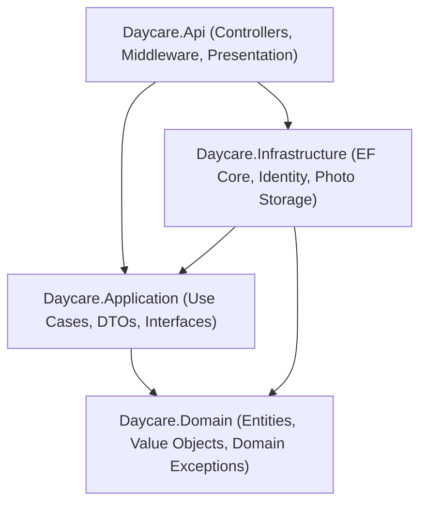

# Architecture and Design

The backend follows Clean Architecture principles separated into four distinct projects, enforcing a strict unidirectional dependency rule toward the Domain core.

## Dependency Rule
- Daycare.Domain depends on nothing.
- Daycare.Application depends only on Daycare.Domain.
- Daycare.Infrastructure depends on Daycare.Application and Daycare.Domain.
- Daycare.Api depends on Daycare.Infrastructure and Daycare.Application.



## Request Lifecycle
HTTP requests follow the middleware pipeline in Daycare.Api (Program.cs):
1. ExceptionHandlingMiddleware: Intercepts all exceptions, mapping domain, validation, and authorization errors to RFC 7807 Problem Details.
2. OpenAPI and Scalar: In Development, serves /openapi/v1.json and /scalar/v1 endpoints.
3. UseHttpsRedirection: Enforces HTTPS traffic.
4. UseCors: Applies cross-origin resource sharing policies before authentication.
5. UseAuthentication: Validates JWT Bearer tokens, decrypts claims, and executes OnTokenValidated to verify user active status.
6. UseAuthorization: Enforces route and role authorization policies.
7. MapControllers: Routes request to matching controller action methods.

## Use Case Pattern
Application logic is structured using single-purpose Use Case classes (for example, CheckInUseCase, GenerateInvoicesUseCase). Each use case:
- Takes a typed Request record.
- Validates inputs using dedicated Validator classes.
- Enforces cross-cutting permissions through IAccessGuard and ICurrentUser.
- Executes domain business rules on aggregate roots.
- Persists changes via IApplicationDbContext.
- Returns a typed DTO or void.

## Error Handling and Problem Details
All API errors follow RFC 7807 Problem Details with Content-Type application/problem+json:
- ValidationFailedException: HTTP 400 Bad Request with a dictionary of field error messages (`VALIDATION_FAILED`).
- UnauthorizedException: HTTP 401 Unauthorized for missing authentication, invalid credentials, or locked accounts (`UNAUTHORIZED`, `INVALID_CREDENTIALS`, `ACCOUNT_LOCKED`).
- ForbiddenException: HTTP 403 Forbidden with access denial explanation (`FORBIDDEN`).
- NotFoundException: HTTP 404 Not Found with descriptive detail (`NOT_FOUND`).
- ConflictException: HTTP 409 Conflict with state mismatch detail (`CONFLICT`, `DUPLICATE_NAME`, `DUPLICATE_LINK`, `EMAIL_IN_USE`).
- BadHttpRequestException / DomainRuleException: HTTP 413 Payload Too Large when payload exceeds size limit (`PAYLOAD_TOO_LARGE`, `PHOTO_TOO_LARGE`).
- DomainRuleException: HTTP 422 Unprocessable Entity with error code and detail (`PICKUP_NOT_AUTHORIZED`, `ID_NOT_VERIFIED`, `CHILD_INACTIVE`, `ALREADY_CHECKED_IN`, `ALREADY_CHECKED_OUT`, `NOT_CHECKED_IN`, `NO_CLASSROOM`, `NO_PICKUP_GUARDIAN`, `CLASSROOM_FULL`, `CLASSROOM_INACTIVE`, `OVERPAYMENT`, `INVOICE_VOID`, `INVOICE_HAS_PAYMENTS`, `PAYMENT_ALREADY_VOIDED`, `DUPLICATE_REFERENCE`, `ENTRY_LOCKED`, `ALREADY_ACKNOWLEDGED`).
- Unhandled Exception: HTTP 500 Internal Server Error with generic message (`INTERNAL_ERROR`).

Example 422 Problem Details payload:
```json
{
  "title": "Business rule violation",
  "status": 422,
  "detail": "Guardian is not authorized to pick up this child.",
  "code": "PICKUP_NOT_AUTHORIZED",
  "traceId": "00-4bf92f3577b34da6a3ce929d0e0e4736-00f067aa0ba902b7-00"
}
```

---

---

## Project Structure

Folder layout to depth 3:

```text
.
├── docs/                                  # OpenAPI specifications and API documentation contracts
│   └── openapi.json
├── frontend/                              # Angular single-page web client
│   ├── public/                            # Static web assets and icons
│   │   └── favicon.ico
│   └── src/                               # TypeScript application source
│       ├── app/                           # Core services, guards, interceptors, layouts, and pages
│       └── environments/                  # Environment API target configuration
├── scripts/                               # Operational helper scripts
│   └── smoke.sh
├── src/                                   # .NET backend application source code
│   ├── Daycare.Api/                       # ASP.NET Core presentation layer, controllers, and middleware
│   │   ├── Controllers/
│   │   ├── Middleware/
│   │   ├── Properties/
│   │   └── Services/
│   ├── Daycare.Application/               # Application use cases, validation rules, DTOs, and abstractions
│   │   ├── Abstractions/
│   │   ├── Common/
│   │   └── Features/
│   ├── Daycare.Domain/                    # Domain entities, value objects, exceptions, and enums
│   │   ├── Common/
│   │   ├── Entities/
│   │   ├── Enums/
│   │   ├── Exceptions/
│   │   └── ValueObjects/
│   └── Daycare.Infrastructure/            # EF Core persistence, Identity, and infrastructure services
│       ├── Common/
│       ├── Configuration/
│       ├── Identity/
│       ├── Persistence/
│       └── Services/
└── tests/                                 # Automated test suites
    ├── Daycare.Application.Tests/         # Feature use case and authorization tests
    ├── Daycare.Architecture.Tests/        # NetArchTest architectural boundary and convention tests
    └── Daycare.Domain.Tests/              # Domain entity and business logic tests
```

---
