# Data Model and Schema

The data model is managed by Entity Framework Core targeting PostgreSQL, comprising 15 domain tables and 7 ASP.NET Identity tables.

### Database Tables

#### Table `classrooms`

| Column | Type | Nullable |
|---|---|---|
| `id` | `uuid` | `false` |
| `capacity` | `integer` | `false` |
| `created_at` | `timestamp with time zone` | `false` |
| `description` | `character varying(500)` | `true` |
| `is_active` | `boolean` | `false` |
| `max_age_months` | `integer` | `false` |
| `max_children_per_staff` | `integer` | `false` |
| `min_age_months` | `integer` | `false` |
| `name` | `character varying(100)` | `false` |
| `updated_at` | `timestamp with time zone` | `false` |

**Constraints, Indexes and Foreign Keys:**

- **Primary Key**: `pk_classrooms` (`Id`)
- **Check Constraint**: `ck_classrooms_capacity` (`capacity > 0`)
- **Check Constraint**: `ck_classrooms_max_age_months` (`max_age_months >= min_age_months`)
- **Check Constraint**: `ck_classrooms_max_children_per_staff` (`max_children_per_staff > 0`)
- **Check Constraint**: `ck_classrooms_min_age_months` (`min_age_months >= 0`)

#### Table `fee_plans`

| Column | Type | Nullable |
|---|---|---|
| `id` | `uuid` | `false` |
| `created_at` | `timestamp with time zone` | `false` |
| `description` | `character varying(500)` | `true` |
| `is_active` | `boolean` | `false` |
| `monthly_amount` | `numeric(12,2)` | `false` |
| `name` | `character varying(100)` | `false` |
| `updated_at` | `timestamp with time zone` | `false` |

**Constraints, Indexes and Foreign Keys:**

- **Primary Key**: `pk_fee_plans` (`Id`)
- **Check Constraint**: `ck_fee_plans_monthly_amount` (`monthly_amount >= 0`)

#### Table `staff`

| Column | Type | Nullable |
|---|---|---|
| `id` | `uuid` | `false` |
| `created_at` | `timestamp with time zone` | `false` |
| `deleted_at` | `timestamp with time zone` | `true` |
| `email` | `character varying(256)` | `false` |
| `first_name` | `character varying(100)` | `false` |
| `hire_date` | `date` | `false` |
| `is_active` | `boolean` | `false` |
| `is_deleted` | `boolean` | `false` |
| `job_title` | `character varying(100)` | `false` |
| `last_name` | `character varying(100)` | `false` |
| `phone` | `character varying(30)` | `false` |
| `updated_at` | `timestamp with time zone` | `false` |
| `user_id` | `uuid` | `true` |
| `photo_content_type` | `character varying(30)` | `true` |
| `photo_key` | `character varying(120)` | `true` |
| `photo_size_bytes` | `integer` | `true` |
| `photo_updated_at` | `timestamp with time zone` | `true` |

**Constraints, Indexes and Foreign Keys:**

- **Primary Key**: `pk_staff` (`Id`)
- **Check Constraint**: `ck_staff_photo_all_or_none` (`num_nonnulls(photo_key, photo_content_type, photo_size_bytes, photo_updated_at) IN (0, 4)`)
- **Index**: `ix_staff_user_id` UNIQUE (`UserId`) WHERE `user_id IS NOT NULL`

#### Table `guardians`

| Column | Type | Nullable |
|---|---|---|
| `id` | `uuid` | `false` |
| `address` | `character varying(500)` | `true` |
| `created_at` | `timestamp with time zone` | `false` |
| `deleted_at` | `timestamp with time zone` | `true` |
| `email` | `character varying(256)` | `true` |
| `first_name` | `character varying(100)` | `false` |
| `is_deleted` | `boolean` | `false` |
| `last_name` | `character varying(100)` | `false` |
| `phone` | `character varying(30)` | `false` |
| `updated_at` | `timestamp with time zone` | `false` |
| `user_id` | `uuid` | `true` |
| `photo_content_type` | `character varying(30)` | `true` |
| `photo_key` | `character varying(120)` | `true` |
| `photo_size_bytes` | `integer` | `true` |
| `photo_updated_at` | `timestamp with time zone` | `true` |

**Constraints, Indexes and Foreign Keys:**

- **Primary Key**: `pk_guardians` (`Id`)
- **Check Constraint**: `ck_guardians_photo_all_or_none` (`num_nonnulls(photo_key, photo_content_type, photo_size_bytes, photo_updated_at) IN (0, 4)`)
- **Index**: `ix_guardians_phone` (`Phone`)
- **Index**: `ix_guardians_user_id` UNIQUE (`UserId`) WHERE `user_id IS NOT NULL`

#### Table `children`

| Column | Type | Nullable |
|---|---|---|
| `id` | `uuid` | `false` |
| `allergies` | `character varying(1000)` | `true` |
| `classroom_id` | `uuid` | `true` |
| `created_at` | `timestamp with time zone` | `false` |
| `date_of_birth` | `date` | `false` |
| `deleted_at` | `timestamp with time zone` | `true` |
| `dietary_notes` | `character varying(1000)` | `true` |
| `enrollment_date` | `date` | `false` |
| `fee_plan_id` | `uuid` | `true` |
| `first_name` | `character varying(100)` | `false` |
| `gender` | `character varying(10)` | `false` |
| `is_deleted` | `boolean` | `false` |
| `last_name` | `character varying(100)` | `false` |
| `medical_notes` | `character varying(2000)` | `true` |
| `status` | `character varying(20)` | `false` |
| `updated_at` | `timestamp with time zone` | `false` |
| `photo_content_type` | `character varying(30)` | `true` |
| `photo_key` | `character varying(120)` | `true` |
| `photo_size_bytes` | `integer` | `true` |
| `photo_updated_at` | `timestamp with time zone` | `true` |

**Constraints, Indexes and Foreign Keys:**

- **Primary Key**: `pk_children` (`Id`)
- **Check Constraint**: `ck_children_photo_all_or_none` (`num_nonnulls(photo_key, photo_content_type, photo_size_bytes, photo_updated_at) IN (0, 4)`)
- **Index**: `ix_children_classroom_id` (`ClassroomId`)
- **Index**: `ix_children_fee_plan_id` (`FeePlanId`)
- **Index**: `ix_children_status` (`Status`)
- **Index**: `ix_children_last_name_first_name` (`LastName`, `FirstName`)
- **Foreign Key**: `fk_children_classrooms_classroom_id` (`ClassroomId`) -> `classrooms` (OnDelete: `Restrict`)
- **Foreign Key**: `fk_children_fee_plans_fee_plan_id` (`FeePlanId`) -> `fee_plans` (OnDelete: `Restrict`)

#### Table `child_guardians`

| Column | Type | Nullable |
|---|---|---|
| `id` | `uuid` | `false` |
| `can_pick_up` | `boolean` | `false` |
| `child_id` | `uuid` | `false` |
| `created_at` | `timestamp with time zone` | `false` |
| `guardian_id` | `uuid` | `false` |
| `is_emergency_contact` | `boolean` | `false` |
| `is_payer` | `boolean` | `false` |
| `is_primary_contact` | `boolean` | `false` |
| `relationship` | `character varying(30)` | `false` |
| `updated_at` | `timestamp with time zone` | `false` |

**Constraints, Indexes and Foreign Keys:**

- **Primary Key**: `pk_child_guardians` (`Id`)
- **Index**: `ix_child_guardians_child_id` UNIQUE (`ChildId`) WHERE `is_primary_contact = true`
- **Index**: `ix_child_guardians_guardian_id` (`GuardianId`)
- **Index**: `ix_child_guardians_child_id_guardian_id` UNIQUE (`ChildId`, `GuardianId`)
- **Foreign Key**: `fk_child_guardians_children_child_id` (`ChildId`) -> `children` (OnDelete: `Restrict`)
- **Foreign Key**: `fk_child_guardians_guardians_guardian_id` (`GuardianId`) -> `guardians` (OnDelete: `Restrict`)

#### Table `staff_classrooms`

| Column | Type | Nullable |
|---|---|---|
| `staff_id` | `uuid` | `false` |
| `classroom_id` | `uuid` | `false` |
| `assigned_at` | `timestamp with time zone` | `false` |

**Constraints, Indexes and Foreign Keys:**

- **Primary Key**: `pk_staff_classrooms` (`StaffId`, `ClassroomId`)
- **Index**: `ix_staff_classrooms_classroom_id` (`ClassroomId`)
- **Foreign Key**: `fk_staff_classrooms_classrooms_classroom_id` (`ClassroomId`) -> `classrooms` (OnDelete: `Cascade`)
- **Foreign Key**: `fk_staff_classrooms_staff_staff_id` (`StaffId`) -> `staff` (OnDelete: `Cascade`)

#### Table `attendance_records`

| Column | Type | Nullable |
|---|---|---|
| `id` | `uuid` | `false` |
| `absence_reason` | `character varying(300)` | `true` |
| `check_in_at` | `timestamp with time zone` | `true` |
| `check_out_at` | `timestamp with time zone` | `true` |
| `checked_in_by_guardian_id` | `uuid` | `true` |
| `checked_in_by_name` | `character varying(200)` | `true` |
| `checked_in_by_user_id` | `uuid` | `true` |
| `checked_out_by_guardian_id` | `uuid` | `true` |
| `checked_out_by_name` | `character varying(200)` | `true` |
| `checked_out_by_user_id` | `uuid` | `true` |
| `child_id` | `uuid` | `false` |
| `classroom_id` | `uuid` | `false` |
| `created_at` | `timestamp with time zone` | `false` |
| `date` | `date` | `false` |
| `late_minutes` | `integer` | `false` |
| `notes` | `character varying(500)` | `true` |
| `pickup_id_verified` | `boolean` | `true` |
| `status` | `character varying(10)` | `false` |
| `updated_at` | `timestamp with time zone` | `false` |

**Constraints, Indexes and Foreign Keys:**

- **Primary Key**: `pk_attendance_records` (`Id`)
- **Check Constraint**: `ck_attendance_records_checkout_after_checkin` (`check_out_at IS NULL OR check_out_at >= check_in_at`)
- **Check Constraint**: `ck_attendance_records_status_checkin` (`(status = 'Present' AND check_in_at IS NOT NULL) OR (status = 'Absent' AND check_in_at IS NULL AND check_out_at IS NULL)`)
- **Index**: `ix_attendance_records_checked_in_by_guardian_id` (`CheckedInByGuardianId`)
- **Index**: `ix_attendance_records_checked_out_by_guardian_id` (`CheckedOutByGuardianId`)
- **Index**: `ix_attendance_records_classroom_id` (`ClassroomId`)
- **Index**: `ix_attendance_records_child_id_date` UNIQUE (`ChildId`, `Date`)
- **Index**: `ix_attendance_records_date_classroom_id` (`Date`, `ClassroomId`)
- **Foreign Key**: `fk_attendance_records_guardians_checked_in_by_guardian_id` (`CheckedInByGuardianId`) -> `guardians` (OnDelete: `Restrict`)
- **Foreign Key**: `fk_attendance_records_guardians_checked_out_by_guardian_id` (`CheckedOutByGuardianId`) -> `guardians` (OnDelete: `Restrict`)
- **Foreign Key**: `fk_attendance_records_children_child_id` (`ChildId`) -> `children` (OnDelete: `Restrict`)
- **Foreign Key**: `fk_attendance_records_classrooms_classroom_id` (`ClassroomId`) -> `classrooms` (OnDelete: `Restrict`)

#### Table `daily_reports`

| Column | Type | Nullable |
|---|---|---|
| `id` | `uuid` | `false` |
| `child_id` | `uuid` | `false` |
| `classroom_id` | `uuid` | `false` |
| `created_at` | `timestamp with time zone` | `false` |
| `date` | `date` | `false` |
| `mood` | `character varying(20)` | `true` |
| `notes` | `character varying(2000)` | `true` |
| `updated_at` | `timestamp with time zone` | `false` |

**Constraints, Indexes and Foreign Keys:**

- **Primary Key**: `pk_daily_reports` (`Id`)
- **Index**: `ix_daily_reports_classroom_id` (`ClassroomId`)
- **Index**: `ix_daily_reports_child_id_date` UNIQUE (`ChildId`, `Date`)
- **Foreign Key**: `fk_daily_reports_children_child_id` (`ChildId`) -> `children` (OnDelete: `Restrict`)
- **Foreign Key**: `fk_daily_reports_classrooms_classroom_id` (`ClassroomId`) -> `classrooms` (OnDelete: `Restrict`)

#### Table `daily_report_entries`

| Column | Type | Nullable |
|---|---|---|
| `id` | `uuid` | `false` |
| `amount_eaten` | `character varying(10)` | `true` |
| `created_at` | `timestamp with time zone` | `false` |
| `created_by_name` | `character varying(200)` | `false` |
| `created_by_user_id` | `uuid` | `false` |
| `daily_report_id` | `uuid` | `false` |
| `description` | `character varying(1000)` | `true` |
| `diaper_type` | `character varying(10)` | `true` |
| `ended_at` | `timestamp with time zone` | `true` |
| `entry_type` | `character varying(20)` | `false` |
| `meal_type` | `character varying(20)` | `true` |
| `occurred_at` | `timestamp with time zone` | `false` |
| `updated_at` | `timestamp with time zone` | `false` |

**Constraints, Indexes and Foreign Keys:**

- **Primary Key**: `pk_daily_report_entries` (`Id`)
- **Index**: `ix_daily_report_entries_daily_report_id_occurred_at` (`DailyReportId`, `OccurredAt`)
- **Foreign Key**: `fk_daily_report_entries_daily_reports_daily_report_id` (`DailyReportId`) -> `daily_reports` (OnDelete: `Cascade`)

#### Table `incidents`

| Column | Type | Nullable |
|---|---|---|
| `id` | `uuid` | `false` |
| `acknowledged_at` | `timestamp with time zone` | `true` |
| `acknowledged_by_guardian_id` | `uuid` | `true` |
| `action_taken` | `character varying(2000)` | `true` |
| `child_id` | `uuid` | `false` |
| `classroom_id` | `uuid` | `false` |
| `created_at` | `timestamp with time zone` | `false` |
| `description` | `character varying(2000)` | `false` |
| `occurred_at` | `timestamp with time zone` | `false` |
| `parent_notified_at` | `timestamp with time zone` | `true` |
| `parent_notified_by_name` | `character varying(200)` | `true` |
| `reported_by_name` | `character varying(200)` | `false` |
| `reported_by_user_id` | `uuid` | `false` |
| `severity` | `character varying(10)` | `false` |
| `type` | `character varying(20)` | `false` |
| `updated_at` | `timestamp with time zone` | `false` |

**Constraints, Indexes and Foreign Keys:**

- **Primary Key**: `pk_incidents` (`Id`)
- **Index**: `ix_incidents_acknowledged_by_guardian_id` (`AcknowledgedByGuardianId`)
- **Index**: `ix_incidents_classroom_id` (`ClassroomId`)
- **Index**: `ix_incidents_child_id_occurred_at` (`ChildId`, `OccurredAt`)
- **Foreign Key**: `fk_incidents_guardians_acknowledged_by_guardian_id` (`AcknowledgedByGuardianId`) -> `guardians` (OnDelete: `Restrict`)
- **Foreign Key**: `fk_incidents_children_child_id` (`ChildId`) -> `children` (OnDelete: `Restrict`)
- **Foreign Key**: `fk_incidents_classrooms_classroom_id` (`ClassroomId`) -> `classrooms` (OnDelete: `Restrict`)

#### Table `announcements`

| Column | Type | Nullable |
|---|---|---|
| `id` | `uuid` | `false` |
| `audience` | `character varying(15)` | `false` |
| `body` | `character varying(4000)` | `false` |
| `classroom_id` | `uuid` | `true` |
| `created_at` | `timestamp with time zone` | `false` |
| `created_by_name` | `character varying(200)` | `false` |
| `created_by_user_id` | `uuid` | `false` |
| `expires_at` | `timestamp with time zone` | `true` |
| `published_at` | `timestamp with time zone` | `false` |
| `title` | `character varying(200)` | `false` |
| `updated_at` | `timestamp with time zone` | `false` |

**Constraints, Indexes and Foreign Keys:**

- **Primary Key**: `pk_announcements` (`Id`)
- **Check Constraint**: `ck_announcements_audience_classroom` (`(audience = 'Classroom' AND classroom_id IS NOT NULL) OR (audience <> 'Classroom' AND classroom_id IS NULL)`)
- **Index**: `ix_announcements_classroom_id` (`ClassroomId`)
- **Foreign Key**: `fk_announcements_classrooms_classroom_id` (`ClassroomId`) -> `classrooms` (OnDelete: `Restrict`)

#### Table `invoices`

| Column | Type | Nullable |
|---|---|---|
| `id` | `uuid` | `false` |
| `amount_paid` | `numeric(12,2)` | `false` |
| `child_id` | `uuid` | `false` |
| `created_at` | `timestamp with time zone` | `false` |
| `currency` | `character(3)` | `false` |
| `due_date` | `date` | `false` |
| `guardian_id` | `uuid` | `false` |
| `invoice_number` | `character varying(30)` | `false` |
| `issue_date` | `date` | `false` |
| `period_end` | `date` | `false` |
| `period_start` | `date` | `false` |
| `status` | `character varying(15)` | `false` |
| `total_amount` | `numeric(12,2)` | `false` |
| `updated_at` | `timestamp with time zone` | `false` |
| `void_reason` | `character varying(300)` | `true` |
| `voided_at` | `timestamp with time zone` | `true` |

**Constraints, Indexes and Foreign Keys:**

- **Primary Key**: `pk_invoices` (`Id`)
- **Check Constraint**: `ck_invoices_amount_paid` (`amount_paid >= 0`)
- **Check Constraint**: `ck_invoices_total_amount` (`total_amount >= 0`)
- **Index**: `ix_invoices_guardian_id` (`GuardianId`)
- **Index**: `ix_invoices_invoice_number` UNIQUE (`InvoiceNumber`)
- **Index**: `ix_invoices_child_id_period_start` UNIQUE (`ChildId`, `PeriodStart`) WHERE `status <> 'Void'`
- **Index**: `ix_invoices_status_due_date` (`Status`, `DueDate`)
- **Foreign Key**: `fk_invoices_children_child_id` (`ChildId`) -> `children` (OnDelete: `Restrict`)
- **Foreign Key**: `fk_invoices_guardians_guardian_id` (`GuardianId`) -> `guardians` (OnDelete: `Restrict`)

#### Table `invoice_lines`

| Column | Type | Nullable |
|---|---|---|
| `id` | `uuid` | `false` |
| `created_at` | `timestamp with time zone` | `false` |
| `description` | `character varying(300)` | `false` |
| `invoice_id` | `uuid` | `false` |
| `line_total` | `numeric(12,2)` | `false` |
| `line_type` | `character varying(15)` | `false` |
| `quantity` | `integer` | `false` |
| `sort_order` | `integer` | `false` |
| `unit_price` | `numeric(12,2)` | `false` |
| `updated_at` | `timestamp with time zone` | `false` |

**Constraints, Indexes and Foreign Keys:**

- **Primary Key**: `pk_invoice_lines` (`Id`)
- **Check Constraint**: `ck_invoice_lines_quantity` (`quantity > 0`)
- **Check Constraint**: `ck_invoice_lines_unit_price` (`line_type = 'Adjustment' OR unit_price >= 0`)
- **Index**: `ix_invoice_lines_invoice_id` (`InvoiceId`)
- **Foreign Key**: `fk_invoice_lines_invoices_invoice_id` (`InvoiceId`) -> `invoices` (OnDelete: `Cascade`)

#### Table `payments`

| Column | Type | Nullable |
|---|---|---|
| `id` | `uuid` | `false` |
| `amount` | `numeric(12,2)` | `false` |
| `created_at` | `timestamp with time zone` | `false` |
| `invoice_id` | `uuid` | `false` |
| `method` | `character varying(15)` | `false` |
| `notes` | `character varying(500)` | `true` |
| `paid_at` | `timestamp with time zone` | `false` |
| `recorded_by_name` | `character varying(200)` | `false` |
| `recorded_by_user_id` | `uuid` | `false` |
| `reference` | `character varying(100)` | `true` |
| `updated_at` | `timestamp with time zone` | `false` |
| `void_reason` | `character varying(300)` | `true` |
| `voided_at` | `timestamp with time zone` | `true` |
| `voided_by_name` | `character varying(200)` | `true` |
| `voided_by_user_id` | `uuid` | `true` |

**Constraints, Indexes and Foreign Keys:**

- **Primary Key**: `pk_payments` (`Id`)
- **Check Constraint**: `ck_payments_amount` (`amount > 0`)
- **Index**: `ix_payments_invoice_id` (`InvoiceId`)
- **Index**: `ix_payments_method_reference` UNIQUE (`Method`, `Reference`) WHERE `reference IS NOT NULL AND voided_at IS NULL`
- **Foreign Key**: `fk_payments_invoices_invoice_id` (`InvoiceId`) -> `invoices` (OnDelete: `Restrict`)

### ASP.NET Identity Tables

Authentication and user identity are managed by ASP.NET Core Identity across seven database tables:

- `AspNetUsers`: Stores user accounts, credentials (password hashes), email addresses, active status flags, lockout timestamps, and password change indicators.
- `AspNetRoles`: Stores system role definitions (Administrator, Staff, Parent).
- `AspNetUserRoles`: Maps users to roles via composite primary key (`UserId`, `RoleId`) with cascading foreign keys to `AspNetUsers` and `AspNetRoles`.
- `AspNetUserClaims`: Stores identity claims associated with user accounts (`UserId` foreign key to `AspNetUsers`).
- `AspNetRoleClaims`: Stores identity claims associated with system roles (`RoleId` foreign key to `AspNetRoles`).
- `AspNetUserLogins`: Stores external authentication provider login associations for users (`UserId` foreign key to `AspNetUsers`).
- `AspNetUserTokens`: Stores authentication and security tokens per user (`UserId` foreign key to `AspNetUsers`).

### Entity-Relationship Diagram

```mermaid
erDiagram
    classrooms |o--o{ children : "classroom_id (Restrict)"
    fee_plans |o--o{ children : "fee_plan_id (Restrict)"
    children ||--o{ child_guardians : "child_id (Restrict)"
    guardians ||--o{ child_guardians : "guardian_id (Restrict)"
    staff ||--o{ staff_classrooms : "staff_id (Cascade)"
    classrooms ||--o{ staff_classrooms : "classroom_id (Cascade)"
    children ||--o{ attendance_records : "child_id (Restrict)"
    classrooms ||--o{ attendance_records : "classroom_id (Restrict)"
    guardians |o--o{ attendance_records : "checked_in_by (Restrict)"
    guardians |o--o{ attendance_records : "checked_out_by (Restrict)"
    children ||--o{ daily_reports : "child_id (Restrict)"
    classrooms ||--o{ daily_reports : "classroom_id (Restrict)"
    daily_reports ||--o{ daily_report_entries : "daily_report_id (Cascade)"
    children ||--o{ incidents : "child_id (Restrict)"
    classrooms ||--o{ incidents : "classroom_id (Restrict)"
    guardians |o--o{ incidents : "acknowledged_by (Restrict)"
    classrooms |o--o{ announcements : "classroom_id (Restrict)"
    children ||--o{ invoices : "child_id (Restrict)"
    guardians ||--o{ invoices : "guardian_id (Restrict)"
    invoices ||--o{ invoice_lines : "invoice_id (Cascade)"
    invoices ||--o{ payments : "invoice_id (Restrict)"
    AspNetUsers |o--o| staff : "linked by user_id no FK"
    AspNetUsers |o--o| guardians : "linked by user_id no FK"
    AspNetUsers ||--o{ AspNetUserRoles : "user_id (Cascade)"
    AspNetRoles ||--o{ AspNetUserRoles : "role_id (Cascade)"
    AspNetUsers ||--o{ AspNetUserClaims : "user_id (Cascade)"
    AspNetRoles ||--o{ AspNetRoleClaims : "role_id (Cascade)"
    AspNetUsers ||--o{ AspNetUserLogins : "user_id (Cascade)"
    AspNetUsers ||--o{ AspNetUserTokens : "user_id (Cascade)"
```

---
